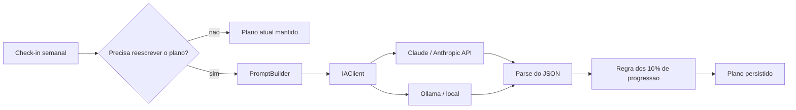

# SeuCorre

SeuCorre e um SaaS de treinos de corrida com onboarding, geracao de plano, check-in semanal, historico de treinos e adaptacao guiada por regras de negocio no backend.

> Status atual: MVP em desenvolvimento.
> O backend principal esta funcional e coberto por testes. Parte do frontend e de algumas integracoes ainda esta em evolucao.

## Stack

- Backend: Java 17, Spring Boot 3.2, Spring Security, Spring Data JPA, Flyway, Redis
- Frontend: React 18, Vite, React Router, React Query, Tailwind
- Banco: PostgreSQL
- IA: provider configuravel com suporte atual a Ollama e Anthropic
- Testes backend: JUnit, Spring Test, Testcontainers

## Como a IA funciona

A IA e um componente do sistema, nao a regra principal: ela sugere, o backend valida e decide o que persiste. Detalhes em [`.claude/AI_GUIDELINES.md`](.claude/AI_GUIDELINES.md) e decisoes em [`.claude/DECISIONS.md`](.claude/DECISIONS.md).



Decisoes de engenharia:

- **Provider trocavel por configuracao** (`IA_PROVIDER`): o dominio depende so da interface `IAClient`. Claude (`AnthropicClient`), Ollama para desenvolvimento local sem custo (`OllamaClient`) ou modo manual sem IA (`ManualOnlyIAClient`).
- **Guardrail deterministico depois do LLM**: a regra dos 10% (o volume semanal nao sobe mais de 10%) roda em Java sobre toda resposta do modelo em `GeradorPlanoIA`. Regra de seguranca nao fica so no prompt.
- **Resiliencia na chamada ao modelo**: timeout, retry com backoff exponencial (Resilience4j) e `IAUnavailableException` quando o provider falha.
- **Funciona sem IA**: o plano inicial vem de presets (IA opcional quando nao ha preset) e, em modo manual, a analise do check-in usa regras deterministicas (`ManualCheckinAnalysisService`).

Proximos passos: eval automatizado da saida do LLM (Claude x Ollama) e saida estruturada com tool calling.

## Como rodar localmente

### Pre-requisitos

- Java 17
- Node.js 20+ com `npm`
- Docker
- Docker Compose v2 (`docker compose`) ou Compose legado (`docker-compose`)
- portas `5432`, `6379`, `5050`, `8080` e `5173` livres

### 1. Subir a infraestrutura local

Use o comando que existir na sua maquina:

```bash
docker compose up -d db redis pgadmin
```

ou:

```bash
docker-compose up -d db redis pgadmin
```

Servicos locais:

- PostgreSQL: `localhost:5432`
- Redis: `localhost:6379`
- pgAdmin: `http://localhost:5050`

Validacao rapida:

```bash
docker ps
```

Voce deve ver os containers `seucorre-db`, `seucorre-redis` e `seucorre-pgadmin` em estado `Up`.

### 2. Subir o backend

O perfil `dev` ja aponta por padrao para `localhost`, entao o caminho mais simples e carregar as variaveis de `.env.example` e iniciar o Spring Boot.

#### Bash / WSL / Linux

```bash
set -a
source .env.example
set +a
./mvnw spring-boot:run
```

Se preferir exportar manualmente:

```bash
export SPRING_PROFILES_ACTIVE=dev
export DB_URL=jdbc:postgresql://localhost:5432/seucorre_db
export DB_USERNAME=user
export DB_PASSWORD=password
export REDIS_HOST=localhost
export REDIS_PORT=6379
export JWT_SECRET=$(openssl rand -base64 48)
export TREINO_GERACAO_MODE=preset
export TREINO_GERACAO_FALLBACK_TO_IA=false
./mvnw spring-boot:run
```

#### PowerShell

```powershell
$env:SPRING_PROFILES_ACTIVE="dev"
$env:DB_URL="jdbc:postgresql://localhost:5432/seucorre_db"
$env:DB_USERNAME="user"
$env:DB_PASSWORD="password"
$env:REDIS_HOST="localhost"
$env:REDIS_PORT="6379"
$env:JWT_SECRET=[Convert]::ToBase64String([byte[]](1..48 | ForEach-Object { Get-Random -Maximum 256 }))
$env:TREINO_GERACAO_MODE="preset"
$env:TREINO_GERACAO_FALLBACK_TO_IA="false"
.\mvnw.cmd spring-boot:run
```

API local:

- `http://localhost:8080`

Sinal esperado de sucesso:

- backend sobe sem erro de Flyway
- Tomcat inicia na porta `8080`

### 3. Subir o frontend

```bash
cd src/front
npm install
npm run dev
```

Frontend local:

- `http://localhost:5173`

`VITE_API_URL` e opcional em desenvolvimento porque o `vite.config.js` ja faz proxy de `/api` e `/auth` para `http://localhost:8080`. Use `src/front/.env.example` apenas se quiser apontar para outra API.

### 4. Fluxo completo de validacao

1. Suba `db`, `redis` e `pgadmin`.
2. Inicie o backend em outro terminal.
3. Inicie o frontend em outro terminal.
4. Abra `http://localhost:5173`.
5. Use a API em `http://localhost:8080`.

### Problemas comuns

- `docker compose` nao existe: use `docker-compose`.
- erro de conexao no Postgres ou Redis: confirme que os containers estao `Up` e que as portas `5432` e `6379` nao estao ocupadas por outros processos.
- erro de Flyway ao iniciar o backend: normalmente indica que o banco nao subiu ou que `DB_URL`, `DB_USERNAME` e `DB_PASSWORD` nao batem com o `docker-compose.yml`.
- frontend sobe mas a API falha: confirme que o backend esta escutando em `http://localhost:8080`.

## Deploy

O runbook de deploy esta em `DEPLOY.md`.
Ele cobre:

- `.env.production`
- `docker-compose.prod.yml`
- build separado de frontend e backend
- uso de proxy reverso para TLS
- smoke test e logs

## Modos de geracao de plano

### `preset`

Modo padrao do MVP. Hoje cobre:

- objetivos `SAUDE_GERAL`, `COMPLETAR_5K` e `COMPLETAR_10K`
- niveis `INICIANTE` e `INTERMEDIARIO`
- 3 ou 4 dias por semana
- 8 semanas por plano

### `ia`

Modo opcional para gerar o plano via provider configurado.

Variaveis relevantes:

- `IA_PROVIDER=ollama` ou `anthropic`
- `OLLAMA_BASE_URL`
- `OLLAMA_MODEL`
- `ANTHROPIC_API_KEY`

## Testes e validacao

Backend:

```bash
mvn clean compile
./mvnw -B -ntp verify
```

Frontend:

```bash
cd src/front
npm run lint
npm run typecheck
npm run build
```

CI atual:

- roda `./mvnw -B -ntp verify`
- valida o build da imagem Docker do backend
